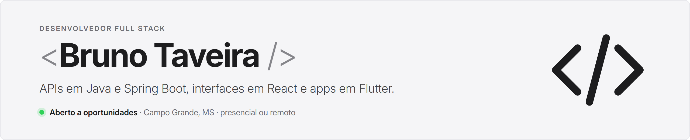

  <em>Desenvolvedor Full Stack · Campo Grande, MS · Aberto a oportunidades</em>

  <code>Java</code> • <code>Spring Boot</code> • <code>Ruby on Rails</code> • <code>React</code> • <code>TypeScript</code> 
  <code>Flutter</code> • <code>Dart</code> • <code>MySQL</code> • <code>Power BI</code>

  
  
  

---

### 🧠 Sobre mim

- 💻 Desenvolvedor full stack: back-end com Java/Spring Boot e Ruby on Rails, front-end com React e mobile com Flutter.
- 🏢 Experiência em:
  - **Jera**: back-end em Rails e apps em Flutter, em squads de produto de ponta a ponta (2023–2025).
  - **SulBiologic**: análise de dados e o sistema interno que substituiu as planilhas de metas e campanhas (2025–atual).
- 🌎 Aberto a vagas de desenvolvimento, presencial em Campo Grande ou remoto.

### 🛠️ Projetos

- [**sulbiologic-hub**](https://github.com/brunotaveiradasilva/sulbiologic-hub): hub interno de uma distribuidora, em uso diário: metas de venda, campanhas de fornecedores, comparativo de vendas e almoxarifado. React + TypeScript + Spring Boot. [▶ demo](https://brunotaveiradasilva.github.io/sulbiologic-hub/demo/)
- [**society**](https://github.com/brunotaveiradasilva/society): app do futebol da semana: organiza a lista do WhatsApp, sorteia os times e controla quem pagou, sincronizado em tempo real. Flutter + Firestore. [▶ abrir](https://brunotaveiradasilva.github.io/society/)
- [**focaai**](https://github.com/brunotaveiradasilva/focaai): app de estudos para ENEM e vestibulares. Expo + React Native, API em Spring Boot.
- [**prummo-engenharia**](https://github.com/brunotaveiradasilva/prummo-engenharia): site de um escritório de projetos de engenharia em BIM. HTML, CSS e JS sem build. [▶ site](https://brunotaveiradasilva.github.io/prummo-engenharia/)
- [**portfolio**](https://github.com/brunotaveiradasilva/portfolio): meu site pessoal, com animações guiadas pela rolagem e sem biblioteca de animação. React + TypeScript. [▶ site](https://brunotaveiradasilva.github.io/portfolio/)

  <em>Estudando, construindo e aprendendo no caminho.</em> ☕

